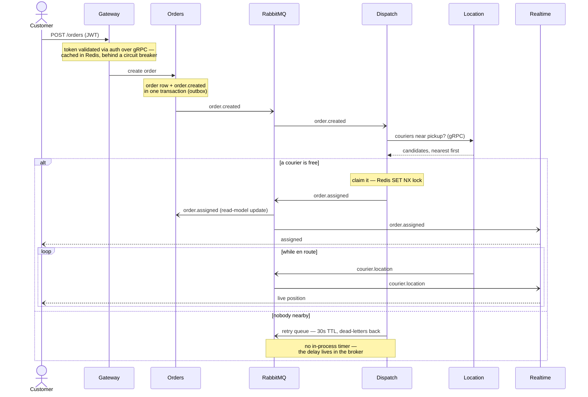

# realtime-courier-network

The backend for an on-demand delivery flow: a customer places an order, the
system finds the nearest free courier and assigns it, and the customer follows
that courier on a live map until the delivery is done — or cancelled, in which
case the courier goes back into the pool.

The delivery domain is mostly a vehicle. What I wanted to work through is the
plumbing that sits underneath any event-driven system of this shape:

- keeping a database row and the event that announces it from ever disagreeing,
- handing a scarce resource (a courier) to exactly one order at a time,
- retrying work that currently has nowhere to go, without a single in-process timer,
- and making sure one service falling over doesn't drag the rest down with it.

Six services written in NestJS, talking over gRPC for the synchronous calls and
RabbitMQ for everything asynchronous. Postgres — with PostGIS for the spatial
queries — is the source of truth. Redis handles caches, the dispatch lock, and
the WebSocket authorization checks.

## The services

| Service | Port | Role |
|---|---|---|
| gateway | 4000 | Single entry point. Validates the JWT (cached in Redis, behind a circuit breaker), enforces idempotency on writes, proxies to the rest. |
| auth | 3001, gRPC 50052 | Register / login / logout, JWT issuance, a Redis token blocklist, and per-account login lockout. Other services validate tokens against it over gRPC. |
| orders | 3002 | Order lifecycle and its state machine. Publishes domain events through an outbox; projects `order.assigned` back onto its own table. |
| location | 3003, gRPC 50051 | Courier positions in a PostGIS `geography` column with a spatial index. Answers "who is near this point" over gRPC. |
| dispatch | 3005 | A worker, not an API. Consumes new orders, picks the nearest online courier, locks it, and assigns — or schedules a retry when nobody is around. |
| realtime | 3004 | The WebSocket layer. Authenticates on the handshake, then pushes order and location updates to the customers watching. |

Three shared packages back them: `types` (event contracts and the RabbitMQ
topology in one place, so a routing-key typo is a compile error rather than a
silently dropped message), `runtime` (config, logging, the circuit breaker,
production guards), and `events` (the RabbitMQ wrapper and the outbox).

## What happens when an order is placed

This is the path a single order takes, and it touches most of the parts worth
talking about.



1. The customer POSTs to the gateway. The gateway validates the token against
   auth over gRPC — but only on a cache miss, and the whole call sits behind a
   circuit breaker, so if auth is down the gateway fails fast instead of piling
   up three-second timeouts.
2. orders writes two rows in one transaction: the order itself, and an
   `order.created` row in an outbox table. Either both land or neither does. A
   background loop polls the outbox and publishes to RabbitMQ a moment later. If
   the broker were down, the order would still be saved and the event would go
   out once it recovered.
3. dispatch is subscribed to that event. It asks location for couriers near the
   pickup (gRPC, circuit-breakered again), walks the list nearest-first, and
   claims one with a Redis lock — `SET NX` with a TTL, released later by a small
   Lua script so it can only ever delete its own lock. The first courier it
   locks is the one it assigns.
4. If nobody is nearby, dispatch publishes the order to a queue that has no
   consumer and a 30-second message TTL. Thirty seconds later RabbitMQ
   dead-letters it straight back onto the dispatch queue and the attempt runs
   again with a wider search radius. No `setTimeout`, nothing lost on a restart —
   the delay lives in the broker.
5. The assignment goes out as `order.assigned`, again through the outbox. orders
   consumes it and updates its own row's courier and status — its read model,
   kept current from the event rather than by letting dispatch reach into another
   service's table. realtime consumes the same event and pushes it to whoever is
   subscribed to that order.
6. As the courier moves, location publishes position updates. realtime throttles
   them per courier and forwards each to the room for the order that courier is
   currently on, so the customer watches the marker move.
7. If the customer cancels, the `order.cancelled` event reaches dispatch, which
   releases the courier's lock — the compensating half of the saga — and the
   courier is free again.

## The patterns, and why each is here

**Transactional outbox.** Writing to the database and publishing to a broker are
two separate systems; you cannot commit to both atomically. So the event goes
into the same transaction as the state change, and a separate publisher ships
it. This is what keeps an order from existing with no event to trigger its
dispatch.

**Dead-letter + TTL retry queue.** A consumer-less queue with a message TTL that
dead-letters back to the working queue gives you durable, delayed retries without
an in-process scheduler that a restart would wipe out.

**Distributed lock.** `SET NX EX` in Redis is the atomic "claim this courier"
primitive; the Lua compare-and-delete release means two dispatcher instances
can't hand the same courier to two orders.

**Circuit breaker.** Around every gRPC call that leaves a service. Five failures
and it opens, rejecting instantly for thirty seconds before letting a single
probe through. It's the difference between one service being down and all of them
hanging on it.

**WebSocket handshake auth.** The token is checked while the connection is being
established, not after — so by the time a client can send anything, it is already
known who they are.

**Read-model projection.** orders never lets another service write its table. It
listens for `order.assigned` and updates itself, idempotently, so a redelivered
event does no harm.

**Saga compensation.** The distributed "undo" for a cancel is a new forward
action — release the lock — not a rollback, because the earlier steps already
committed.

Alongside those are the ordinary-but-necessary pieces: refresh-free JWTs with a
Redis blocklist and login lockout, an idempotency layer keyed by user and route
so a retried POST does not create two orders, structured JSON logs that carry a
request id across every service, and production guards that refuse to boot on a
dev secret or with schema auto-sync left on.

## Running it

Node 22 and pnpm, plus Docker for the infrastructure.

```
cp .env.example .env
pnpm install
pnpm start:infra      # Postgres, Redis, RabbitMQ
pnpm dev              # all six services with live reload
```

Services create their own tables on first boot — schema sync is on in
development and hard-off in production. RabbitMQ loads its full topology
(exchanges, queues, bindings, the dead-letter and retry wiring) from a
definitions file at startup, so there is nothing to set up by hand.

Run them individually if you prefer:

```
pnpm dev:gateway
pnpm dev:auth
pnpm dev:order
pnpm dev:location
pnpm dev:dispatch
pnpm dev:realtime
```

## Layout

```
apps/                 the six services
packages/
  types/              event contracts, enums, RabbitMQ topology constants
  runtime/            config, logging, circuit breaker, prod guards, DB options
  events/             RabbitMQ wrapper and the transactional outbox
proto/                gRPC contracts (auth, location)
infrastructure/
  docker/             Postgres init, RabbitMQ topology
```

## What is deliberately not here

This is a study of the patterns above rather than a finished product, and it
reads more clearly for being small. A few things are consciously left out:

- Auth issues a single short-lived token. No refresh-token rotation, no OAuth —
  the blocklist and lockout are enough to make the point.
- There is no metrics-and-dashboards layer. The services emit structured JSON
  logs tied together by a request id, which is enough to follow a call across
  all six; standing up Prometheus and Grafana on top would mostly repeat an
  observability story told elsewhere, so it stays out of this one.
- There is no user interface. The WebSocket flow is exercised with a small
  client script, not a frontend.
- Everything runs on a single node through Docker Compose — no Kubernetes, no
  multi-region, nothing managed.
- Tests are smoke-level and manual rather than an automated suite.

Each of those has an obvious place it would slot into, and the code is laid out
so it could. None of it was needed to show how the pieces fit.

## License

MIT. See [LICENSE](LICENSE).
