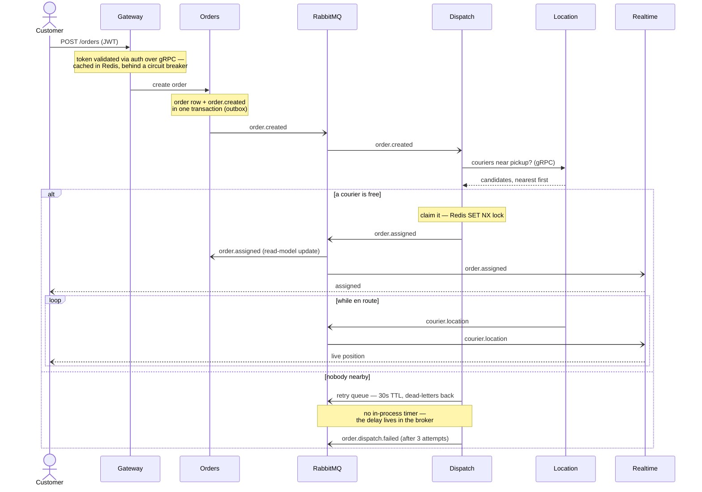

# realtime-courier-network

Event-driven backend for on-demand courier dispatch - six NestJS services that
carry an order from *placed* to *assigned and tracked live*, and the
distributed-systems plumbing that makes that reliable.

**Stack** — TypeScript · NestJS · PostgreSQL / PostGIS · Redis · RabbitMQ · gRPC · WebSocket · Docker

**What it demonstrates**

- **Transactional outbox** — the order row and its event commit together, or not at all
- **Distributed Redis lock** — a courier goes to exactly one order
- **Broker-driven retry** — delayed retries with no in-process timer
- **Hand-rolled circuit breaker** — no library; fails fast when a dependency is down
- **Saga compensation** — a cancel releases the courier as a forward action
- **CQRS read-model projection** — each service owns its table, updated from events
- **PostGIS geospatial search** — nearest online courier over a spatial index
- **WebSocket handshake auth + idempotent writes**

gRPC carries the synchronous calls, RabbitMQ everything asynchronous; Postgres
(with PostGIS) is the source of truth, and Redis holds the caches, the dispatch
lock, and the WebSocket auth checks.

## The services

| Service | Port | Role |
|---|---|---|
| gateway | 4000 | Single entry point. Validates the JWT (cached in Redis, behind a circuit breaker), enforces idempotency on writes, proxies to the rest. |
| auth | 3001, gRPC 50052 | Register / login / logout, JWT issuance, a Redis token blocklist, and per-account login lockout. Other services validate tokens against it over gRPC. |
| orders | 3002 | Order lifecycle and its state machine. Publishes domain events through an outbox; projects dispatch's outcome (`order.assigned` or `order.dispatch.failed`) back onto its own table. |
| location | 3003, gRPC 50051 | Each courier's current position in a PostGIS `geography` column with a spatial index. Answers "who is near this point" over gRPC. |
| dispatch | 3005 | A worker, not an API. Consumes new orders, picks the nearest online courier, locks it, and assigns — or schedules a retry when nobody is around, and marks the order `dispatch_failed` after the third attempt. Frees the courier on delivery or cancel. |
| realtime | 3004 | The WebSocket layer. Authenticates on the handshake, then pushes order and location updates to the customers watching. |

Three shared packages back them: `types` (event contracts and the RabbitMQ
topology in one place, so a routing-key typo is a compile error rather than a
silently dropped message), `runtime` (config, logging, the circuit breaker,
production guards), and `events` (the RabbitMQ wrapper and the outbox).

## What happens when an order is placed

This is the path a single order takes — the notes on the diagram call out the
pieces that matter.



## Key engineering decisions

A few forks in the road, and why this branch:

**Outbox over dual-write.** The database and the broker are two systems you can't
commit to atomically. The event goes into the same transaction as the state
change and a separate publisher ships it, marking it sent only once the broker
confirms — so an order can never exist with no event to dispatch it.

**A broker-driven retry over an in-process scheduler.** Delayed retries live in a
consumer-less queue with a message TTL that dead-letters back to the working
queue — durable across restarts, with no `setTimeout` to lose.

**A hand-rolled circuit breaker over a library.** Under a hundred lines with no
dependency, around every gRPC call: five failures and it opens, failing fast for
thirty seconds; then it goes half-open, where one success closes it and one
failure opens it again.

**gRPC for the synchronous calls, RabbitMQ for the rest.** Typed contracts where
a caller genuinely waits for an answer (token validation, "who's nearby"); a
decoupled bus for everything that shouldn't block a request.

**scrypt over bcrypt.** bcrypt's native build was fragile on the Node version in
use; scrypt ships inside Node's `crypto`, so there is no native compile step and
the hashing runs async, off the event loop.

**A pessimistic row lock over optimistic versioning.** A status transition reads
its order `FOR UPDATE` inside the transaction, so two concurrent updates
serialize instead of racing — without surfacing a version-conflict error to the
caller.

**Each service owns its data.** orders never lets another service write its
table; it projects `order.assigned` onto its own read model, idempotently, so a
redelivered event does no harm.

The ordinary-but-necessary pieces sit under the same rules: refresh-free JWTs
with a Redis blocklist and login lockout, idempotency keyed by user and route,
structured JSON logs carrying a request id across every service, and production
guards that refuse to boot on a dev secret and force schema auto-sync off.

## Running it

Node 22 and pnpm, plus Docker for the infrastructure.

```
cp .env.example .env
pnpm install
pnpm start:infra      # Postgres, Redis, RabbitMQ
pnpm dev              # all six services with live reload
```

Services create their own tables on first boot — schema sync is on in
development and hard-off in production. RabbitMQ loads its full topology
(exchanges, queues, bindings, the dead-letter and retry wiring) from a
definitions file at startup, so there is nothing to set up by hand.

Once the services are up, seed a few online couriers so dispatch has someone
to assign — without it a new order finds nobody and, once its retries run out,
ends as `dispatch_failed`:

```
pnpm seed
```

The seed also gives each courier a login (`courier1@rcn.dev` to
`courier5@rcn.dev`) and adds `admin@rcn.dev`, all with the password
`demo-password`, so you can act as whichever courier an order went to.

Run them individually if you prefer:

```
pnpm dev:gateway
pnpm dev:auth
pnpm dev:order
pnpm dev:location
pnpm dev:dispatch
pnpm dev:realtime
```

Or run the whole stack — all six services and the infrastructure — in Docker
with one command, no local Node required:

```
docker compose up --build
```

The gateway comes up on the same `:4000`, and `pnpm seed` works against it
just the same.

## Layout

```
apps/                 the six services
packages/
  types/              event contracts, enums, RabbitMQ topology constants
  runtime/            config, logging, circuit breaker, prod guards, DB options
  events/             RabbitMQ wrapper and the transactional outbox
proto/                gRPC contracts (auth, location)
infrastructure/
  docker/             Postgres init, RabbitMQ topology
```

## API by example

A few core calls through the gateway on `/api/v1`; authenticated routes take a
bearer token from register or login. The full set, with the token chained
between requests, is in the
[Postman collection](postman/realtime-courier-network.postman_collection.json).

**Register** — `POST /api/v1/auth/register`

```json
{
  "email": "customer@example.com",
  "password": "demo-password",
  "role": "customer"
}
```

→ `201`, returning `{ "user": { "id": "…", "email": "customer@example.com", "role": "customer" }, "accessToken": "eyJ…" }`.

**Place an order** — `POST /api/v1/orders` with `Authorization: Bearer <token>`

```json
{
  "pickupLat": 41.037,
  "pickupLng": 28.985,
  "dropoffLat": 40.99,
  "dropoffLng": 29.027,
  "priority": "normal"
}
```

→ `201`, unassigned:

```json
{
  "id": "22222222-2222-4222-8222-222222222222",
  "orderNumber": "ORD-MK3P8Q2Z-4F9A1C",
  "customerId": "11111111-1111-4111-8111-111111111111",
  "status": "pending",
  "priority": "normal",
  "pickupLat": 41.037,
  "pickupLng": 28.985,
  "dropoffLat": 40.99,
  "dropoffLng": 29.027,
  "createdAt": "2026-01-15T09:24:11.204Z"
}
```

**Follow it** — `GET /api/v1/orders/{id}`. A second or two later the same order
reads `"status": "assigned"` with `"courierId": "a0000000-…-03"` filled in:
dispatch found the nearest online courier, locked it, and the assignment
propagated back onto the order's own record. That one field change is the whole
asynchronous path. With nobody in range — try a pickup at `10.0, 10.0` — it reads
`dispatch_failed` instead, about a minute and three attempts later.

**Deliver it** — only the courier an order went to can advance it, and the seed
gave that courier a login: an id ending in `03` is `courier3@rcn.dev`. Log in
with `POST /api/v1/auth/login`, then send `PATCH /api/v1/orders/{id}/status` with
the courier's token, once for each step:

```json
{ "status": "picked_up" }
```

`in_transit` and `delivered` follow the same way. On `delivered`, dispatch
releases its lock and the courier is free for the next order. A customer token
gets `403` here.

## Deliberately out of scope

A study reads more clearly for staying small, so some things are left out on
purpose — each with an obvious production home:

- **Metrics dashboards.** Observability here is correlation IDs across
  structured logs; a Prometheus/Grafana stack would repeat ground a separate
  telemetry project already covers.
- **Refresh-token rotation and OAuth.** Auth issues one short-lived token with a
  Redis `jti` blocklist and login lockout — revocation, the hard half, is done;
  rotation is the production extension.
- **Pagination.** List endpoints cap at 50; keyset pagination is where this
  grows under real volume.
- **Multi-node and Kubernetes.** Everything runs on a single node. What scales
  is the design — the outbox, the locks, the idempotent consumers — not this
  compose file.
- **Broad test coverage.** The pure core — the circuit breaker and the order
  state machine — is unit-tested; wider integration and end-to-end suites are
  left for a real deployment.

## License

MIT. See [LICENSE](LICENSE).
