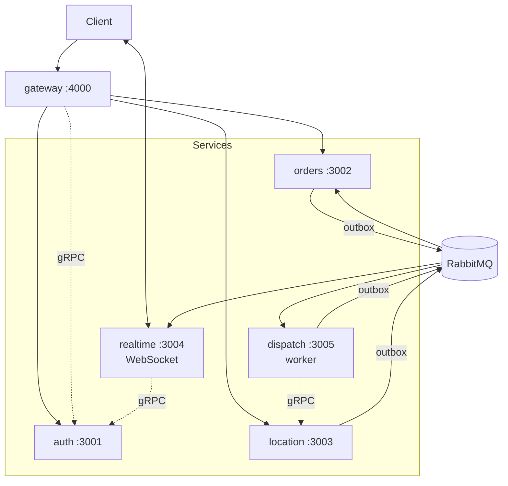
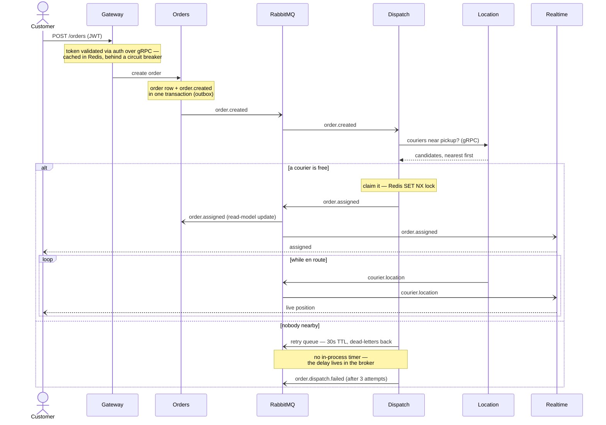

# realtime-courier-network

Event-driven backend for on-demand courier dispatch - six NestJS services that
carry an order from *placed* to *assigned and tracked live*, and the
distributed-systems plumbing that makes that reliable.

**Stack** — TypeScript · NestJS · PostgreSQL / PostGIS · Redis · RabbitMQ · gRPC · WebSocket · Docker

**What it demonstrates**

- **Transactional outbox** — the order row and its event commit together, or not at all
- **Distributed Redis lock** — a courier goes to exactly one order
- **Broker-driven retry** — delayed retries with no in-process timer
- **Hand-rolled circuit breaker** — no library; fails fast when a dependency is down
- **Saga compensation** — a cancel releases the courier as a forward action
- **CQRS read-model projection** — each service owns its table, updated from events
- **PostGIS geospatial search** — nearest online courier over a spatial index
- **WebSocket handshake auth + idempotent writes**

## Architecture



Solid lines are HTTP, dotted lines gRPC, and everything through RabbitMQ is an
event. Postgres (with PostGIS) is the source of truth, one schema per service;
Redis holds the token cache, idempotency keys, the courier lock and courier
presence.

| Service | Port | Role |
|---|---|---|
| gateway | 4000 | Single entry point. Validates the JWT (cached in Redis, behind a circuit breaker), enforces idempotency on writes, proxies to the rest. |
| auth | 3001, gRPC 50052 | Register / login / logout, JWT issuance, a Redis token blocklist and per-account login lockout. Validates tokens for the others over gRPC. |
| orders | 3002 | Order lifecycle and its state machine. Publishes events through an outbox and projects dispatch's outcome back onto its own table. |
| location | 3003, gRPC 50051 | Each courier's current position in a PostGIS `geography` column. Answers "who is near this point" over gRPC. |
| dispatch | 3005 | A worker, not an API. Locks the nearest online courier and assigns it; retries through the broker when nobody is around and gives up after three attempts. Frees the courier on delivery or cancel. |
| realtime | 3004 | The WebSocket layer. Authenticates on the handshake, then pushes order and courier updates to whoever is watching the order. |

Three shared packages back them: `types` (event contracts and the RabbitMQ
topology, so a wrong routing key or payload field is a compile error rather than
a silently dropped message), `runtime` (config, logging, the circuit breaker,
production guards) and `events` (the RabbitMQ wrapper and the outbox).

## What happens when an order is placed



## Key engineering decisions

**Outbox over dual-write.** The database and the broker cannot be committed to
atomically, so the event goes into the same transaction as the state change. A
separate publisher ships it and marks it sent only once the broker confirms.
The commit itself wakes the publisher, so an event reaches the broker within
milliseconds; a one-second sweep picks up whatever a crash or a broker outage
left behind. Each publisher claims its rows with `FOR UPDATE SKIP LOCKED`, so
several copies of a service never ship the same row twice.

**Idempotent consumers over exactly-once delivery.** The outbox delivers at
least once, so consumers take a repeat safely: dispatch skips an attempt it has
already logged, and orders applies a dispatch outcome with an update that only
moves an order out of `pending`. When two workers take the same event at the
same moment, a unique index on order and attempt lets one outcome in; the other
worker gives back the courier it had claimed.

**A broker-driven retry over an in-process scheduler.** Delayed retries wait in
a consumer-less queue whose message TTL dead-letters them back to the working
queue: durable across restarts, with no `setTimeout` to lose. The retry is
written through the outbox together with the attempt it follows, so the two
cannot come apart.

**A hand-rolled circuit breaker over a library.** Under a hundred lines with no
dependency, around every gRPC call. Five failures open it and it fails fast for
thirty seconds; then one success closes it and one failure opens it again.

**A pessimistic row lock over optimistic versioning.** A status transition reads
its order `FOR UPDATE` inside the transaction, so two concurrent updates
serialize instead of racing, with no version-conflict error for the caller.

Also in place: a request id carried from the gateway into the logs of every
service it calls, idempotency keyed by user and route, and production guards
that refuse to boot on a dev secret and force schema auto-sync off.

## Running it

Node 22 and pnpm, plus Docker for the infrastructure.

```
cp .env.example .env
pnpm install
pnpm start:infra      # Postgres, Redis, RabbitMQ
pnpm dev              # all six services with live reload
```

There is nothing to set up by hand: services create their tables on first boot
(schema sync is on in development, forced off in production) and RabbitMQ loads
its whole topology from a definitions file.

Once the services are up, seed from another terminal:

```
pnpm seed
```

It puts five online couriers near the demo pickup and gives them logins,
`courier1@rcn.dev` to `courier5@rcn.dev`, plus `admin@rcn.dev`, all with the
password `demo-password`. Without it an order finds nobody and ends as
`dispatch_failed`.

Or run everything in Docker, with no local Node:

```
docker compose up --build
```

The gateway is on the same `:4000`; seed it with `bash scripts/seed.sh`.

## API by example

Through the gateway. The full set, with tokens chained between requests, is in
the [Postman collection](postman/realtime-courier-network.postman_collection.json).

**Register** — `POST /api/v1/auth/register` returns `201` and an `accessToken`:

```json
{ "email": "customer@example.com", "password": "demo-password", "role": "customer" }
```

**Place an order** — `POST /api/v1/orders` with that token. It comes back `201`
with `"status": "pending"` and no courier yet:

```json
{
  "pickupLat": 41.037,
  "pickupLng": 28.985,
  "dropoffLat": 40.99,
  "dropoffLng": 29.027,
  "priority": "normal"
}
```

**Follow it** — `GET /api/v1/orders/{id}`. A moment later it reads
`"status": "assigned"` with `"courierId": "a0000000-…-03"`: dispatch found the
nearest online courier, locked it, and the assignment propagated back onto the
order's own record. With nobody in range (try a pickup at `10.0, 10.0`) it reads
`dispatch_failed` instead, about a minute and three attempts later.

**Deliver it** — only the courier an order went to can advance it, and the seed
gave that courier a login: an id ending in `03` is `courier3@rcn.dev`. Log in
with `POST /api/v1/auth/login`, then send `PATCH /api/v1/orders/{id}/status`
with the courier's token, once each for `picked_up`, `in_transit` and
`delivered`:

```json
{ "status": "picked_up" }
```

On `delivered`, dispatch releases its lock and the courier is free for the next
order. A customer token gets `403` here.

## Watching it live

The realtime service speaks Socket.IO on port 3004, namespace `/ws`. It reads
the bearer token from the handshake (`auth.token`) and refuses the connection
without a valid one. From then on it pushes:

| Event | When | Goes to |
|---|---|---|
| `order:created` | an order is placed | the customer |
| `order:assigned` | dispatch locks a courier | the order's room |
| `courier:location` | the assigned courier reports a position | the order's room |
| `order:status` | the courier advances the order | the order's room |
| `order:cancelled`, `order:dispatch_failed` | the order ends without a delivery | the order's room |

A socket joins an order's room by emitting `subscribe:order` with
`{ "orderId": "…" }`; only that order's customer and courier (or an admin) are
let in.

To watch it without writing a client, leave this running in a second terminal
and work through the calls above:

```
pnpm track customer@example.com demo-password
```

It logs in, connects, subscribes to each order as it appears, and prints
whatever arrives:

```
21:11:09 order:created {"orderId":"2222…","status":"pending"}
21:11:09 subscribed {"orderId":"2222…"}
21:11:11 order:assigned {"orderId":"2222…","courierId":"a0000000-…-03","etaMinutes":1}
21:11:14 courier:location {"courierId":"a0000000-…-03","lat":41.0381,"lng":28.9831}
21:11:15 order:status {"orderId":"2222…","newStatus":"picked_up"}
```

`courier:location` appears once the assigned courier reports a position with
`POST /api/v1/location/update`. A seeded courier that does so is no longer
pinned as online and ages out like a real one until the next `pnpm seed`.

## Load simulation

`sim/` holds a Python simulator that drives the Docker stack through the
gateway like any other client: seeded demand on an open-loop schedule, thirty
courier agents that report positions and deliver, and faults injected by
stopping containers. It reads its measurements from Postgres afterwards and
fails the run if an invariant breaks: a courier holding two orders at once, an
order assigned twice or left pending, an event never published. A queue it
binds to the exchanges for the length of the run counts every event that was
published more than once.

```
pnpm sim:up
pnpm sim scenarios/baseline.toml
```

| Scenario | Orders | Assigned | Time to assign p50 / p95 | Order API p95 | Outbox lag p95 | Duplicate publishes | Invariant violations |
|---|---|---|---|---|---|---|---|
| auth-outage | 123 | 100.0% | 0.011 s / 0.078 s | 15.1 ms | 0.011 s | 0 | 0 |
| baseline | 85 | 100.0% | 0.010 s / 0.065 s | 16.4 ms | 0.014 s | 0 | 0 |
| broker-outage | 74 | 100.0% | 1.530 s / 30.032 s | 14.9 ms | 25.169 s | 0 | 0 |
| dispatch-kill | 76 | 100.0% | 0.012 s / 7.840 s | 15.3 ms | 0.010 s | 0 | 0 |
| ramp | 132 | 100.0% | 0.011 s / 30.090 s | 13.9 ms | 0.009 s | 0 | 0 |
| retry-storm | 63 | 100.0% | 0.010 s / 0.073 s | 13.9 ms | 0.011 s | 0 | 0 |
| scale-out | 68 | 100.0% | 0.018 s / 26.564 s | 18.1 ms | 26.227 s | 0 | 0 |

Thirty simulated couriers on one node (local Docker, 10 CPUs, 7.7 GB), moving
at 150 m/s so a run fits in two to four minutes. Each run writes its full
summary to `sim/results`.

- **baseline** — 0.8 orders a second for two minutes; every order is assigned on
  the first attempt.
- **ramp** — 0.6, 1.2, then 1.8 orders a second. The first two steps assign
  within 70 ms at p95. The third outruns thirty couriers: about a quarter of
  its orders wait for a 30-second retry, and none fail.
- **broker-outage** — RabbitMQ stopped for 15 seconds under load. The ten
  orders placed meanwhile were accepted with no API errors, held in the outbox,
  and dispatched 16.6 seconds after the broker was restarted. None were lost.
- **dispatch-kill** — dispatch killed outright for 10 seconds. The nine orders
  placed meanwhile waited in its queue and were assigned within 1.1 seconds of
  its return, each exactly once.
- **auth-outage** — auth stopped for 30 seconds. Cached tokens carried traffic
  for the first 19 seconds; after that the gateway refused requests in 3 ms at
  the median instead of waiting out a 3-second timeout, and service resumed 22
  seconds after auth returned. 20 of 143 orders were turned away; the 123
  accepted were all delivered.
- **retry-storm** — every order sent three times under one idempotency key:
  189 requests, 63 orders. The concurrent duplicate gets `409`, the later one
  the stored `201`.
- **scale-out** — three copies each of orders, location and dispatch, started
  with `pnpm sim:scale`, and RabbitMQ stopped for 15 seconds under load. The
  dispatch copies shared the assignments 25, 18 and 25; no order went to two
  couriers and no event was published twice. The gateway's HTTP connections
  stayed on one copy of orders and of location, so what competes here is the
  queue consumers and the outbox publishers.

Four fixes came out of these runs. The first baseline had a p95 of 30 seconds:
dispatch asked for only the ten nearest couriers and, when all ten were busy,
waited for a retry while free couriers were in range. Considering every courier
in range brought it under a second. What was left was the outbox, whose
publisher polled once a second, so an event waited half a second on average
before it left. Waking the publisher on commit took the median time to assign
from 0.545 s to 0.010 s and the p95 from 0.975 s to 0.065 s.

The first scale-out run failed: of 68 orders one went to two couriers, and 29
events were published more than once. Every copy's publisher read the same
unpublished rows, and two dispatch workers handed the same event both passed
the already-handled check before either had written its result. The publisher
now claims its rows with `SKIP LOCKED`, and a unique index refuses the second
outcome.

## Deliberately out of scope

Left out on purpose, each with an obvious production home:

- **Metrics dashboards.** Observability here is structured logs with a request
  id; a Prometheus/Grafana stack would repeat ground a separate telemetry
  project already covers.
- **Refresh-token rotation and OAuth.** Auth issues one short-lived token with a
  Redis `jti` blocklist and login lockout. Revocation, the hard half, is done;
  rotation is the production extension.
- **Pagination.** List endpoints cap at 50; keyset pagination is where this
  grows under real volume.
- **Multi-node and Kubernetes.** Everything runs on one machine. The scale-out
  scenario runs three copies of each worker there; separate nodes, a load
  balancer and an orchestrator are the production step.
- **Broad test coverage.** The pure core, the circuit breaker and the order
  state machine, is unit-tested, and the simulator checks the invariants under
  load; integration suites are left for a real deployment.

## License

MIT. See [LICENSE](LICENSE).
